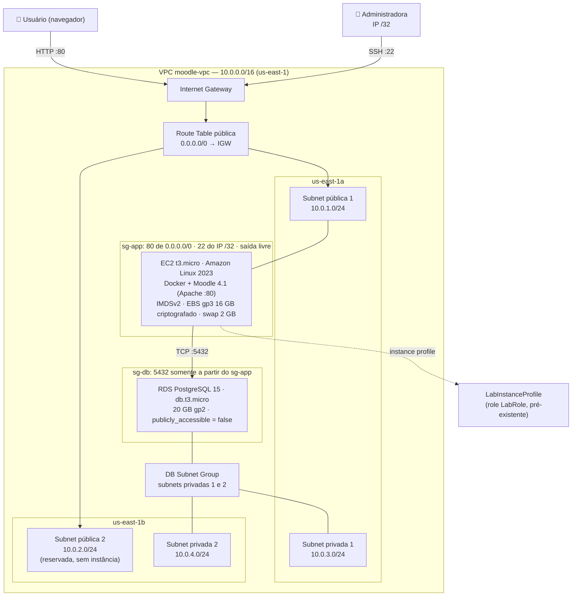

# Design de Arquitetura — Moodle na AWS

**Projeto:** Moodle Docker AWS Challenge  
**Disciplina:** DevOps — ADS UniFAAT 2026.2  
**Aluna:** Eloísa Brandão — RA 2325096  
**Ambiente de nuvem:** AWS Academy Learner Lab (`us-east-1`)  
**Ferramenta de IaC:** Terraform >= 1.5, provider AWS ~> 5.0

---

## Visão Geral

Esta solução implanta o Moodle 4.1 na AWS usando apenas recursos compatíveis com o AWS Academy Learner Lab. O Moodle roda em um contêiner Docker em uma instância EC2 `t3.micro` com Amazon Linux 2023, e persiste os dados em um banco RDS PostgreSQL 15 (`db.t3.micro`) isolado em subnets privadas.

Toda a infraestrutura é provisionada via Terraform, em três módulos (`networking`, `compute` e `database`) integrados pela configuração raiz em `terraform/`. Cada módulo pode ser validado isoladamente, e a ordem de criação é resolvida pelas referências entre eles: rede → banco → EC2.

O ambiente Docker local (`docker/docker-compose.yml`) é a referência de desenvolvimento. Na nuvem, o mesmo `Dockerfile` é reutilizado por um Compose de produção (`terraform/modules/compute/docker-compose.prod.yml`) que não tem serviço de banco: o Moodle conecta-se diretamente ao RDS. O script `user_data.sh` instala o Docker, gera o `.env` com as credenciais, aguarda o RDS, sobe o contêiner e executa o instalador CLI do Moodle no primeiro boot.

As restrições do Learner Lab moldam a arquitetura: não é possível criar recursos IAM, nem usar Route 53, ACM ou CloudFront. Por isso o Moodle é exposto via HTTP na porta 80 pelo DNS público automático da EC2, e a instância usa o instance profile pré-existente `LabInstanceProfile` (role `LabRole`).

---

## Diagrama de Arquitetura

**Fluxo de dados:** Internet → Internet Gateway → Route Table pública → EC2 (sg-app, porta 80) → contêiner Moodle → RDS (sg-db, porta 5432) nas subnets privadas. As subnets privadas não têm rota para o Internet Gateway; o tráfego de retorno do RDS segue a rota local da VPC.

> **Subnets em duas AZs:** o `aws_db_subnet_group` exige subnets em pelo menos duas AZs. O RDS é Single-AZ e a AWS escolhe em qual das duas subnets privadas ele fica. A segunda subnet pública (`us-east-1b`) atende ao enunciado da prova ("pelo menos 2 subnets públicas em AZs diferentes") e permite evoluir para um Load Balancer, que exige duas AZs. Hoje ela não hospeda nenhuma instância.

---

## Decisões de Design

A tabela distingue o que foi **fixado pelos requisitos** do que foi **decidido no projeto**.

| Componente | Escolha | Origem | Justificativa |
|---|---|---|---|
| Tipo da EC2 | `t3.micro` (variável `ec2_instance_type`) | Enunciado da prova | O enunciado da prova exige `t3.micro` e, por ser o requisito mais específico, prevalece sobre a rubrica genérica do template (`t3.medium`). Como 1 GB de RAM é pouco para compilar a imagem Docker e executar o `install.php`, o `user_data.sh` cria um swap de 2 GB antes do build. |
| AMI | Amazon Linux 2023 (data source `aws_ami`, mais recente) | Rubrica | Mantida pela AWS, com Docker 24+ no repositório `dnf`. O data source evita fixar um ID de AMI, que muda por região e por atualização. |
| Engine e classe do banco | RDS PostgreSQL 15, `db.t3.micro`, 20 GB gp2 | Rubrica / prova | Mesma versão major do ambiente local (`postgres:15`); menor classe compatível, suficiente para carga de estudo. |
| Topologia de rede | 2 subnets públicas + 2 privadas em `us-east-1a`/`us-east-1b` | Prova + decisão | Duas AZs exigidas pelo DB Subnet Group e pelo enunciado. A EC2 fica na subnet pública 1 (`map_public_ip_on_launch = true`); o RDS fica nas privadas, sem rota para a internet. |
| Blocos CIDR | VPC `10.0.0.0/16`; públicas `10.0.1.0/24`, `10.0.2.0/24`; privadas `10.0.3.0/24`, `10.0.4.0/24` | Decisão do projeto | Faixa privada RFC 1918 com espaço para crescer; /24 (251 IPs úteis) por subnet é mais que suficiente. |
| Perfil IAM da EC2 | `iam_instance_profile = "LabInstanceProfile"` | Prova / restrição do Learner Lab | O Learner Lab bloqueia a criação de roles e instance profiles. O enunciado da prova pede o perfil pré-existente `LabInstanceProfile`, associado à role `LabRole`. Ele é passado por nome, sem nenhum bloco `resource` ou `data` de IAM. |
| Metadados da EC2 | IMDSv2 obrigatório (`http_tokens = "required"`, hop limit 1) | Decisão (segurança) | Bloqueia o IMDSv1, explorável por SSRF; com hop limit 1, os contêineres não alcançam o IMDS. |
| Implantação do Moodle | `user_data.sh` via `templatefile()` + `docker-compose.prod.yml` + instalador CLI | Decisão do projeto | Deploy reproduzível sem intervenção manual: no primeiro boot, o Moodle já sobe instalado e configurado com o RDS e com o DNS público da EC2 como `wwwroot`. |
| Passagem de credenciais | Variáveis `sensitive` → outputs do módulo database → Base64 no user_data → `.env` com `chmod 600` | Decisão do projeto | Nenhuma senha no código. O Base64 apenas protege caracteres especiais contra o Bash; **não é criptografia** (ver Segurança). |
| Protocolo e DNS | HTTP na porta 80, DNS público da EC2 | Restrição do Learner Lab | ACM, CloudFront e Route 53 não estão disponíveis. |
| Backend do Terraform | Local | Decisão do projeto | Um backend S3 + DynamoDB exigiria criar bucket e tabela fora do Terraform, e as sessões do Learner Lab são temporárias. O `terraform.tfstate` é ignorado pelo `.gitignore` e tratado como sensível. |
| CI do plan | `terraform-plan.yml` em PR (com comentário) e manual | Prova + rubrica | O enunciado exige execução em PR com o plano comentado; a rubrica exige `workflow_dispatch`. O workflow tem os dois gatilhos e falha se o plan falhar. |

---

## Componentes

### Módulo `networking` (`terraform/modules/networking`)

| Recurso | Configuração | Função |
|---|---|---|
| `aws_vpc.main` | `10.0.0.0/16`, DNS support e DNS hostnames habilitados | Rede isolada da solução. Os DNS hostnames são necessários para a EC2 receber um nome público. |
| `aws_subnet.public[0..1]` | `10.0.1.0/24` (1a), `10.0.2.0/24` (1b), IP público automático | Subnets com saída para a internet; a EC2 fica na primeira. |
| `aws_subnet.private[0..1]` | `10.0.3.0/24` (1a), `10.0.4.0/24` (1b), sem IP público | Subnets isoladas para o RDS. |
| `aws_internet_gateway.main` | Associado à VPC | Entrada e saída de internet para as subnets públicas. |
| `aws_route_table.public` + 2 associações | `0.0.0.0/0 → IGW`, associada só às subnets públicas | As subnets privadas usam a route table principal (apenas rota local). |
| `aws_security_group.sg_app` | Entrada 80/tcp de `0.0.0.0/0`; 22/tcp só de `var.ssh_allowed_cidr` (validado como `/32`); saída livre | Firewall da EC2. A saída livre é necessária para `dnf`, download do Moodle e do Compose, e conexão ao RDS. |
| `aws_security_group.sg_db` | Entrada 5432/tcp com origem `sg_app` (referência por SG, não por CIDR) | Firewall do RDS com menor privilégio. |

### Módulo `database` (`terraform/modules/database`)

| Recurso | Configuração | Função |
|---|---|---|
| `aws_db_subnet_group.main` | As 2 subnets privadas (validação: exatamente 2 IDs) | Define onde o RDS pode ser criado (2 AZs). |
| `aws_db_instance.main` | PostgreSQL `15`, `db.t3.micro`, 20 GB gp2, Single-AZ, `publicly_accessible = false`, `vpc_security_group_ids = [sg_db]`, `skip_final_snapshot` configurável | Banco gerenciado do Moodle, sem endpoint público. |

**Outputs:** `rds_endpoint` (host:porta), `db_host`, `rds_port`, `db_name`, `db_username` (sensível) e `db_password` (sensível), consumidos pelo módulo `compute`.

### Módulo `compute` (`terraform/modules/compute`)

| Recurso | Configuração | Função |
|---|---|---|
| `data.aws_ami.amazon_linux_2023` | Owner `amazon`, `al2023-ami-2023*-x86_64`, mais recente | Seleciona a AMI sem fixar um ID. |
| `aws_key_pair.main` | Chave **pública** via `var.ec2_public_key` | Acesso SSH; a chave privada nunca sai da máquina local. |
| `aws_instance.main` | `t3.micro`, subnet pública 1, `sg_app`, `LabInstanceProfile`, IMDSv2, EBS gp3 16 GB criptografado, `user_data_replace_on_change = true` | Servidor do Moodle. |
| `user_data.sh` | Template renderizado com `templatefile()` | Script de boot (detalhado abaixo). |
| `docker-compose.prod.yml` | Serviço `moodle` (build de `docker/Dockerfile`), porta 80, volume `moodle_www` em `/var/moodledata`, `.env` lido com `format: raw` | Sobe o Moodle sem banco local. |

**Etapas do `user_data.sh`:** cria um swap de 2 GB → atualiza pacotes → instala `git`, `jq` e `postgresql15` (`pg_isready`) → instala Docker (verifica >= 24) e o plugin Compose v2 (verifica >= 2.30) → habilita o Docker → obtém o DNS público via IMDSv2 → clona o repositório (`repo_url`/`repo_branch`) → decodifica as credenciais e gera `docker/.env` (`chmod 600`) → aguarda o RDS com `pg_isready` → `docker compose up -d` → aguarda o Apache → executa `admin/cli/install.php` como `www-data` (ou, se o `config.php` já existir, só verifica) → restringe as permissões do `config.php`. O log fica em `/var/log/user-data-moodle.log`, sem imprimir credenciais.

**Outputs:** `public_ip`, `public_dns` e `instance_id`.

### Configuração raiz (`terraform/`)

`versions.tf` (Terraform >= 1.5, AWS ~> 5.0, provider fixo em `us-east-1` com `default_tags`), `main.tf` (integra os módulos), `variables.tf`, `outputs.tf` (`vpc_id`, `ec2_public_dns`, `ec2_public_ip`, `rds_endpoint`, `moodle_url`) e `terraform.tfvars.example` (modelo sem segredos).

---

## Segurança

**Isolamento de rede do banco.** O RDS fica em subnets privadas, sem rota para o Internet Gateway, tem `publicly_accessible = false` (sem endpoint público) e o `sg-db` aceita apenas a porta 5432 com origem no `sg-app`. Somente a EC2 do Moodle alcança o banco, e só por dentro da VPC.

**Menor privilégio nos Security Groups.** O `sg-db` referencia o Security Group da aplicação, e não um bloco CIDR: a permissão acompanha a instância, não um endereço IP. O SSH no `sg-app` é limitado a `var.ssh_allowed_cidr`, uma variável obrigatória, sem valor padrão e validada para aceitar apenas um IPv4 `/32`. Assim, `0.0.0.0/0` é rejeitado pelo próprio Terraform.

**Sem recursos IAM.** Nenhum `aws_iam_*` é declarado. A EC2 usa o perfil pré-existente `LabInstanceProfile`.

**IMDSv2 e disco criptografado.** O IMDSv1 é desativado (`http_tokens = "required"`) e o hop limit 1 impede que contêineres consultem o IMDS. O volume raiz é criptografado (`encrypted = true`).

**Proteção das credenciais:**
- Nenhuma senha em arquivos versionados. As credenciais entram por `terraform.tfvars` (ignorado pelo `.gitignore`) ou por variáveis `TF_VAR_*` vindas de GitHub Secrets no CI.
- `db_username`, `db_password` e `moodle_admin_password` são `sensitive = true` e não aparecem no plan/apply. `ssh_allowed_cidr` também é sensível na raiz, para não publicar o IP da administradora no comentário da PR.
- Riscos residuais documentados: o `terraform.tfstate` guarda os valores sensíveis em texto legível (por isso é ignorado e nunca commitado); o user_data, legível via IMDS dentro da EC2, contém as credenciais em Base64, que é só codificação e **não criptografia**; na EC2, o `.env` tem `chmod 600` (somente root). Fora do Learner Lab, a evolução natural é o AWS Secrets Manager com `manage_master_user_password`.
- No ambiente local, o `docker-compose.yml` lê as variáveis do `docker/.env` (ignorado); o repositório contém apenas o `.env.example`.

**State e CI.** `.terraform/`, `*.tfstate`, `*.tfstate.*`, `*.tfvars`, `*.pem`, `*.key` e `id_rsa` estão no `.gitignore`. O workflow de plan usa permissões mínimas (`contents: read`, `pull-requests: write`) e credenciais temporárias com `AWS_SESSION_TOKEN`.

---

## Escalabilidade

A arquitetura atende ao objetivo educacional, mas tem limitações conhecidas em relação a produção:

- **EC2 única, sem Auto Scaling:** não tolera falha da instância nem da AZ `us-east-1a`.
- **RDS Single-AZ:** sem standby síncrono; uma falha da AZ derruba o banco.
- **Sem Load Balancer:** a URL pública depende do DNS da instância, que muda se ela for recriada.
- **HTTP sem TLS:** credenciais trafegam sem criptografia (ACM indisponível no Learner Lab).
- **Dados locais na EC2:** `/var/moodledata` e o `config.php` ficam no disco da instância; recriar a EC2 exige reinstalar o Moodle (o banco no RDS é preservado).

**Caminho de evolução:**

1. `aws_launch_template` + `aws_autoscaling_group` com mínimo de 2 instâncias, usando as duas subnets públicas já existentes.
2. `aws_lb` (ALB) com terminação TLS via ACM e health check em `/login/index.php`.
3. `multi_az = true` no RDS e backups automáticos com retenção maior.
4. `aws_efs_file_system` para o `moodledata` compartilhado e ElastiCache Redis para sessões e cache.
5. Imagem publicada no Amazon ECR em vez de build na própria EC2, reduzindo o tempo de boot.
6. Backend remoto S3 com lock para o state.

Essas mudanças estão fora do escopo do Learner Lab e do desafio.

---

## Custo Estimado

> **Premissas:** região `us-east-1`, On-Demand, 730 horas/mês, sem Reserved Instances ou Savings Plans. Custos variáveis (transferência de dados, snapshots, requisições) não estão incluídos. Valores em USD. No Learner Lab, o uso é debitado dos créditos educacionais da conta.

| Serviço | Configuração (igual ao Terraform) | Custo (USD/mês) |
|---|---|---|
| Amazon EC2 | `t3.micro`, Linux, On-Demand, 730 h (7,59) + EBS gp3 16 GB (1,28) | 8,87 |
| Amazon RDS for PostgreSQL | `db.t3.micro`, Single-AZ, 730 h + 20 GB gp2 | 15,44 |
| **Subtotal (AWS Pricing Calculator)** | | **24,31** |
| IPv4 público da EC2 | 1 endereço × USD 0,005/h × 730 h | 3,65 |
| VPC, subnets, IGW, route tables, Security Groups | sem cobrança | 0,00 |
| **Total mensal estimado** | | **27,96** |
| **Custo inicial** | | **0,00** |

**Estimativa gerada na AWS Pricing Calculator (EC2 + RDS):**  
[https://calculator.aws/#/estimate?id=234b16dd6885e02d6bf40c21f1332ee99d90c122](https://calculator.aws/#/estimate?id=234b16dd6885e02d6bf40c21f1332ee99d90c122)

> A cobrança de IPv4 público (USD 0,005 por IP por hora, desde fevereiro de 2024) é feita no serviço Amazon VPC e não aparece na estimativa de EC2 da calculadora, por isso foi somada à parte.
>
> **Uso real no Learner Lab:** a infraestrutura só fica ligada durante as sessões de teste e é destruída depois. Com 4 horas de uso, por exemplo, o custo fica em torno de USD 0,15 (27,96 ÷ 730 × 4).
