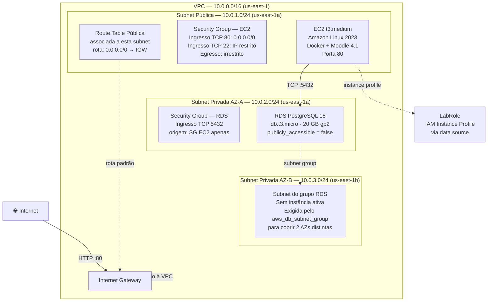

# Design de Arquitetura — Moodle na AWS

**Projeto:** Moodle Docker AWS Challenge  
**Disciplina:** DevOps — ADS UniFAAT 2026.2  
**Ambiente de nuvem:** AWS Learn Lab (us-east-1)  
**Ferramenta de IaC:** Terraform ~> 1.5, provider AWS ~> 5.0

---

## Visão Geral

Esta solução implanta o Moodle 4.1 na AWS usando exclusivamente recursos compatíveis com o AWS Learn Lab. O Moodle roda em um contêiner Docker sobre uma instância EC2 `t3.medium` com Amazon Linux 2023, e persiste dados em um banco RDS PostgreSQL 15 (`db.t3.micro`) isolado em subnets privadas.

Toda a infraestrutura é provisionada via Terraform, organizada em três módulos independentes: `networking` (VPC e rede), `compute` (EC2) e `database` (RDS). Essa separação permite validar e evoluir cada camada sem afetar as demais.

O ambiente Docker local (`docker compose up -d`) serve como referência de desenvolvimento e validação antes do deploy na nuvem. A intenção é manter compatibilidade de configuração entre os dois ambientes no que se refere à versão do PostgreSQL (15) e às configurações essenciais de conexão, viabilizada pelo script `user_data.sh` que será implementado no módulo `compute`.

O AWS Learn Lab impõe restrições que moldam diretamente as decisões de arquitetura: não é possível criar IAM roles, nem usar Route 53, ACM ou CloudFront. Por isso o Moodle é exposto via HTTP na porta 80, usando o DNS público automático da EC2, e o acesso IAM da instância é obtido através do instance profile `LabRole` pré-existente, referenciado como data source.

---

## Diagrama de Arquitetura

> **Nota sobre a Subnet Privada AZ-B:** o recurso `aws_db_subnet_group` do Terraform exige ao menos duas subnets em Availability Zones distintas. A subnet `10.0.3.0/24` em `us-east-1b` cumpre esse requisito técnico, mas não hospeda nenhuma instância RDS ativa — o banco roda exclusivamente em `us-east-1a`. A segunda subnet existe para satisfazer a API da AWS, não para Alta Disponibilidade.

---

## Decisões de Design

A tabela abaixo distingue configurações **fixadas pelo enunciado do desafio** de decisões **tomadas no projeto** com base em restrições técnicas ou de custo.

| Componente | Escolha | Origem da decisão | Justificativa |
|---|---|---|---|
| Tipo da instância EC2 | `t3.medium` | Fixado pelo enunciado | Especificação direta do CHALLENGE.md. 2 vCPUs e 4 GB RAM são suficientes para executar o Moodle em um contêiner Docker com carga educacional. |
| Engine do banco | RDS PostgreSQL 15 | Fixado pelo enunciado | Mantém paridade com o ambiente Docker local (`postgres:15`), eliminando diferenças de comportamento entre desenvolvimento e nuvem. |
| Classe da instância RDS | `db.t3.micro` | Fixado pelo enunciado | Especificação direta do CHALLENGE.md. Instância de baixo custo, adequada ao volume de dados de um ambiente de estudo. |
| AMI da EC2 | Amazon Linux 2023 | Fixado pelo enunciado | Especificação direta do CHALLENGE.md. Distribuição mantida pela AWS, com suporte a Docker via `dnf` e atualizações de segurança regulares. |
| Topologia de rede | 1 subnet pública + 2 privadas | Decisão do projeto | EC2 precisa de acesso externo (HTTP e SSH), portanto fica em subnet pública com `map_public_ip_on_launch = true`. O RDS nunca deve ser exposto à internet, portanto fica em subnet privada. Duas AZs privadas são exigidas pela API do `aws_db_subnet_group`. |
| Acesso IAM da EC2 | `LabRole` via data source | Restrição do ambiente | O AWS Learn Lab bloqueia a criação de `aws_iam_role`, `aws_iam_role_policy` e `aws_iam_instance_profile`. O `LabRole` pré-existente é a única opção disponível e deve ser referenciado via `data "aws_iam_instance_profile"`. |
| Protocolo de acesso | HTTP porta 80, sem TLS | Restrição do ambiente | O AWS Learn Lab não disponibiliza ACM nem CloudFront. Considerando essas restrições e o escopo educacional do desafio, a implementação utiliza HTTP na porta 80, sem configurar TLS. |
| DNS da EC2 | DNS público automático da AWS | Restrição do ambiente | Route 53 é bloqueado no Learn Lab. O DNS no formato `ec2-X-X-X-X.compute-1.amazonaws.com` é gerado automaticamente e suficiente para acessar o Moodle. |
| Backend do Terraform | Local (padrão) | Decisão do projeto | Configurar um backend S3 exigiria provisionar bucket e tabela DynamoDB previamente. Para um desafio individual com sessões temporárias de 4h, o backend local é mais prático. O `terraform.tfstate` é ignorado pelo `.gitignore`. |
| `publicly_accessible` do RDS | `false` | Decisão do projeto (boa prática) | Impede que o RDS receba um endpoint público. Combinado com as subnets privadas e o Security Group restrito, garante que o banco seja acessível apenas pela EC2. |

---

## Componentes

### VPC

A VPC centraliza toda a infraestrutura da solução em um bloco de endereçamento privado isolado.

- **CIDR:** `10.0.0.0/16`
- **Região:** `us-east-1`
- **DNS hostnames:** habilitado (`enable_dns_hostnames = true`) — necessário para que a EC2 receba um DNS público resolvível externamente
- **Recurso Terraform:** `aws_vpc`

### Subnets

| Nome | Tipo | CIDR | AZ | Recurso hospedado |
|---|---|---|---|---|
| Subnet pública | Pública | `10.0.1.0/24` | `us-east-1a` | EC2 (Moodle) |
| Subnet privada AZ-A | Privada | `10.0.2.0/24` | `us-east-1a` | RDS PostgreSQL 15 |
| Subnet privada AZ-B | Privada | `10.0.3.0/24` | `us-east-1b` | Apenas subnet group (sem instância ativa) |

A subnet pública tem `map_public_ip_on_launch = true` para que a EC2 receba IP público automaticamente. As subnets privadas não têm rota para o Internet Gateway.

### Internet Gateway e Route Table

O Internet Gateway (recurso `aws_internet_gateway`) é associado à VPC e permite que a subnet pública envie e receba tráfego da internet.

A Route Table pública (`aws_route_table`) contém a rota padrão `0.0.0.0/0 → IGW` e é associada à subnet pública via `aws_route_table_association`. As subnets privadas não devem possuir rota para o Internet Gateway — esse isolamento é o requisito que garante que o RDS não seja alcançável diretamente pela internet.

### Security Group — EC2

Controla o tráfego de entrada e saída da instância EC2.

| Direção | Protocolo | Porta | Origem/Destino | Finalidade |
|---|---|---|---|---|
| Ingresso | TCP | 80 | `0.0.0.0/0` | Acesso HTTP ao Moodle |
| Ingresso | TCP | 22 | `var.ssh_allowed_cidr` | Acesso SSH administrativo |
| Egresso | Todos | Todos | `0.0.0.0/0` | Permite que a EC2 acesse a internet (pull de imagens Docker, atualizações) — egresso irrestrito previsto nesta arquitetura |

A variável `ssh_allowed_cidr` tem valor padrão `0.0.0.0/0`, conforme definido no desafio para facilitar o ambiente de estudo. **Essa configuração é permissiva: expõe a porta 22 a qualquer origem na internet e não deve ser usada em ambientes de produção.** Sempre que possível, substitua o valor padrão pelo IP administrativo com máscara `/32` (por exemplo, `203.0.113.10/32`) no arquivo `terraform.tfvars`, que é ignorado pelo `.gitignore`.

### Security Group — RDS

Controla o tráfego de entrada da instância RDS.

| Direção | Protocolo | Porta | Origem | Finalidade |
|---|---|---|---|---|
| Ingresso | TCP | 5432 | ID do Security Group da EC2 | Permite conexões PostgreSQL apenas da aplicação |

A origem do ingresso referencia o **ID do Security Group da EC2** (`security_groups = [var.ec2_security_group_id]`), não um bloco CIDR. Isso garante que apenas instâncias EC2 associadas ao SG correto possam conectar ao banco, independentemente de IP.

### Instância EC2

- **Tipo:** `t3.medium` (2 vCPU, 4 GB RAM)
- **AMI:** Amazon Linux 2023, especificada via AMI fixa ou data source `aws_ami`
- **Subnet:** pública (`10.0.1.0/24`, `us-east-1a`)
- **IP público:** atribuído automaticamente (`map_public_ip_on_launch = true` na subnet)
- **Key pair:** criado via `aws_key_pair` com a chave pública fornecida em `var.ec2_public_key`
- **IAM Instance Profile:** `LabRole` referenciado via `data "aws_iam_instance_profile"`
- **User data:** script `user_data.sh` a ser implementado no módulo `compute`, responsável por instalar Docker 24+, Docker Compose v2 e executar `docker compose up -d` no boot da instância

### RDS PostgreSQL

- **Engine:** PostgreSQL 15
- **Classe:** `db.t3.micro`
- **Armazenamento:** 20 GB, tipo `gp2`
- **Multi-AZ:** não previsto na implementação atual (ambiente educacional sem requisito de alta disponibilidade; o atributo `multi_az` não é especificado pelo enunciado do desafio)
- **`publicly_accessible`:** `false`
- **Subnet group:** cobre as duas subnets privadas (`us-east-1a` e `us-east-1b`)
- **Recurso Terraform:** `aws_db_instance` + `aws_db_subnet_group`
- **Credenciais:** fornecidas via variáveis `db_username` e `db_password`, ambas declaradas com `sensitive = true`

---

## Segurança

A solução aplica múltiplas camadas de proteção, seguindo o princípio de defesa em profundidade.

**Isolamento de rede:** o RDS está em subnets privadas cujas route tables não possuem rota padrão `0.0.0.0/0` direcionada ao Internet Gateway. Isso impede que tráfego originado da internet alcance diretamente o banco. Combinado com `publicly_accessible = false` — que impede a atribuição de endpoint público ao RDS — e com o Security Group do RDS, que permite conexões na porta TCP 5432 exclusivamente com origem no Security Group da EC2, o acesso ao banco fica restrito à aplicação dentro da própria VPC.

**Regras de Security Group com menor privilégio:** o SG do RDS aceita conexões na porta 5432 apenas com origem no SG da EC2 — não em blocos CIDR abertos. Isso significa que somente instâncias EC2 associadas ao SG correto podem conectar ao banco, independentemente de onde estejam na rede.

**`publicly_accessible = false`:** o RDS não recebe endpoint público. Combinado com as subnets privadas, garante que o banco seja inacessível diretamente pela internet.

**Credenciais fora do código:** senhas do banco de dados e chave pública SSH são fornecidas via `terraform.tfvars` (ignorado pelo `.gitignore`) e declaradas com `sensitive = true` no Terraform. O `docker-compose.yml` usa interpolação `${VAR}` via arquivo `.env` (também ignorado pelo `.gitignore`) — nenhuma senha aparece em texto literal em arquivos versionados.

**Acesso SSH por variável de CIDR:** a porta 22 da EC2 é liberada para o valor de `var.ssh_allowed_cidr`. O valor padrão `0.0.0.0/0` é definido pelo desafio para facilitar o ambiente de estudo, mas **é uma configuração permissiva que expõe a porta SSH a qualquer endereço IP**. Recomenda-se fortemente substituir esse valor pelo IP administrativo com máscara `/32` no arquivo `terraform.tfvars` antes de executar `terraform apply`.

**LabRole via data source:** nenhum recurso IAM é criado (`aws_iam_role`, `aws_iam_role_policy`, `aws_iam_instance_profile`). O `LabRole` pré-existente é referenciado via `data "aws_iam_instance_profile"`, respeitando as restrições do Learn Lab e o princípio de não criar permissões desnecessárias.

**Estado do Terraform:** o `terraform.tfstate` é ignorado pelo `.gitignore`. O estado local pode conter valores de atributos sensíveis em texto claro — mantê-lo fora do repositório é obrigatório.

**Sem Route 53, ACM ou CloudFront:** esses serviços são bloqueados no Learn Lab. A solução não os referencia, evitando erros de `AccessDenied` no `terraform apply`.

---

## Escalabilidade

A arquitetura atual é adequada para o objetivo educacional, mas tem limitações conhecidas em relação a um ambiente de produção real.

**Limitações do ambiente atual:**

- **EC2 única, sem Auto Scaling:** uma única instância não tolera falhas de hardware. Em produção, um Auto Scaling Group com mínimo de 2 instâncias em AZs distintas resolveria esse ponto.
- **RDS sem Multi-AZ:** o enunciado do desafio não especifica o atributo `multi_az`. Na implementação planejada, `multi_az = false` para manter o custo mínimo. Em produção, `multi_az = true` manteria uma réplica síncrona em standby em outra AZ.
- **Sem Load Balancer:** o acesso direto ao DNS da EC2 não permite distribuição de carga nem failover transparente. Em produção, um Application Load Balancer (ALB) centralizaria o tráfego e desacoplaria a URL pública da instância específica.
- **HTTP sem TLS:** a ausência de HTTPS expõe credenciais em trânsito. Em produção com ACM disponível, o ALB faria terminação TLS com certificado gerenciado.
- **Armazenamento de sessão local:** o Moodle armazena sessões no banco e em disco local da EC2. Com múltiplas instâncias, seria necessário armazenamento de sessão compartilhado (ElastiCache Redis) e sistema de arquivos compartilhado (EFS) para os arquivos do Moodle.

**Caminho de evolução no Terraform:**

Para escalar a solução, as principais mudanças necessárias seriam:

1. Substituir `aws_instance` por `aws_launch_template` + `aws_autoscaling_group`
2. Adicionar `aws_lb` e `aws_lb_target_group` para o ALB
3. Mudar `multi_az = true` na `aws_db_instance`
4. Adicionar `aws_elasticache_replication_group` para sessões Redis
5. Adicionar `aws_efs_file_system` + `aws_efs_mount_target` para arquivos compartilhados

No contexto do AWS Learn Lab, essas evoluções estão fora do escopo da implementação atual do desafio.

---

## Custo Estimado

> **Premissas:** região `us-east-1` (Leste dos EUA — N. da Virgínia), precificação On-Demand, 100% de utilização, estimativa mensal baseada em 730 horas, sem comprometimento de longo prazo (Reserved Instances). Os valores já incluem os custos de armazenamento associados a cada serviço. A estimativa não inclui custos variáveis ou serviços não configurados, como transferência de dados. Os valores podem variar conforme o uso efetivo e a região.

| Serviço | Configuração | Custo (USD/mês) |
|---|---|---|
| Amazon EC2 | `t3.medium`, Linux, On-Demand, 730h, EBS gp3 8 GB incluído | USD 31,01 |
| Amazon RDS for PostgreSQL | `db.t3.micro`, Single-AZ, On-Demand, 730h, 20 GB gp2 incluído | USD 15,44 |
| **Total mensal** | | **USD 46,45** |
| **Custo inicial** | | **USD 0,00** |

> **Estimativa gerada na AWS Pricing Calculator:**
> [https://calculator.aws/#/estimate?id=6c722655f110da07df40c7e501475f0c89929300](https://calculator.aws/#/estimate?id=6c722655f110da07df40c7e501475f0c89929300)

> **Observação sobre o Learn Lab:** o AWS Learn Lab fornece créditos educacionais que podem cobrir parte dos custos durante a sessão ativa. No entanto, esses créditos não garantem ausência de cobranças para todos os recursos ou todas as contas.
